# database/

- `db.py`: opens the database (`DATABASE_URL`, by default `storage/hearline.db`) and brings it up to date at startup; `migrate.py`: applies the Alembic migrations.
- `models.py`: the tables.

Table names start with their kind:

- `dim_`: things that are described (users, topics, stories, clips). Other tables point to them.
- `fact_`: events that happen and pile up over time (episodes made, stories heard, money spent).
- `bridge_`: many-to-many links, such as which user follows which topic.
- `ops_`: internal machinery (the job queue).

| Table | Python class | Holds |
|---|---|---|
| `dim_user` | `User` | The listener |
| `dim_profile` | `Profile` | Their tone, language, voice, length and delivery time (overwritten on change) |
| `dim_topic` | `Topic` | Shared topics, with an optional parent topic |
| `dim_topic_alias` | `TopicAlias` | Phrases users type, mapped to a topic |
| `dim_story` | `Story` | Researched news stories, shared by everyone following the topic |
| `dim_story_clip` | `StoryClip` | Spoken clip per story and voice setting, shared and reused. The script is reused across voices; only the audio is redone |
| `dim_phrase_clip` | `PhraseClip` | Shared spoken phrases: greeting (time of day + first name), one transition per topic, rotating outros. Written and recorded once per setting |
| `fact_episode` | `Episode` | Each user's episode: details, audio path, the settings used, when listened, and only the greeting/transition/outro text (`frame`). Transcript and sources are rebuilt from `fact_episode_story` + the clip scripts. `published_at` is the delivery time |
| `fact_episode_story` | `EpisodeStory` | Every story a user heard, in which episode and position. Step 4 uses it to skip stories heard in the last 14 days. Rows older than 30 days move to `storage/archive/` |
| `fact_cost_event` | `CostEvent` | Every LLM/TTS call and its price; raw rows kept 90 days |
| `fact_cost_daily` | `CostDaily` | Daily totals per stage and model, kept forever: what dashboards read (MoM, YTD) |
| `fact_kpi_daily` | `KpiDaily` | Dashboard KPIs per day × podcast language × voice × topic (`""` = all users; a topic = its followers): new users, episodes made / delivered / started / finished, seconds heard, clips. Additive over days; aggregated by `tracking/kpis.py` |
| `fact_listener_daily` | `ListenerDaily` | One row per user and day they listened (started, finished, seconds heard): unique listeners, retention and stickiness |
| `fact_topic_daily` | `TopicDaily` | Per topic and day: followers (a snapshot taken that day) and stories researched |
| `bridge_user_topic` | `UserTopic` | What each user follows: the one list shared by the Settings page and the pipeline. Per topic: the interest picked, frequency (daily / weekdays / weekly), minutes, weight, keyword filters |
| `ops_job` | `Job` | The work queue; finished jobs are deleted after 7 days, dead ones after 30 |

## Diagram

How to read it: `PK` is the row's id and `FK` points to another table's id. A line between two tables means one row on the `||` side can have many rows on the `o{` side, e.g. one `dim_user` has many `fact_episode` rows. `fact_cost_event`, `fact_cost_daily` and `ops_job` stand alone because they don't link to other tables.

Colours: teal = `dim_` (things described), rose = `fact_` (events that pile up), grey = `bridge_` (links), dashed = `ops_` (machinery).

The diagram is generated from `models.py` by [diagram.py](diagram.py) (paracelsus plus the colours). After changing a table, run `python -m app.database.diagram` from `hearline/backend/`; a test fails if it's out of date.

```mermaid
---
    config:
        layout: elk
---
erDiagram
  bridge_user_topic {
    INTEGER id PK
    INTEGER topic_id FK "indexed"
    INTEGER user_id FK "indexed"
    VARCHAR frequency
    VARCHAR interest
    JSON keyword_filters "nullable"
    JSON subtopics "nullable"
    INTEGER target_minutes "nullable"
    FLOAT weight
  }

  dim_episode_review {
    INTEGER id PK
    DATETIME created_at
    JSON issues "nullable"
    VARCHAR key UK "indexed"
    VARCHAR language
    VARCHAR model
  }

  dim_phrase_clip {
    INTEGER id PK
    VARCHAR audio_path "nullable"
    DATETIME created_at
    FLOAT duration_sec "nullable"
    VARCHAR key "indexed"
    VARCHAR language
    VARCHAR text
    VARCHAR tone
    VARCHAR voice
  }

  dim_profile {
    INTEGER id PK
    INTEGER user_id FK
    INTEGER delivery_hour
    VARCHAR language
    INTEGER target_minutes
    VARCHAR timezone
    VARCHAR tone
    VARCHAR voice
  }

  dim_story {
    INTEGER id PK
    INTEGER topic_id FK "indexed"
    INTEGER update_of_id FK "nullable"
    JSON background "nullable"
    VARCHAR canonical_url UK "indexed"
    JSON embedding "nullable"
    DATETIME first_seen "indexed"
    VARCHAR headline
    INTEGER importance_score
    VARCHAR language "indexed"
    DATETIME published_at "indexed"
    VARCHAR source_name
    JSON sources "nullable"
    VARCHAR status
    JSON subtopics "nullable"
    VARCHAR summary
    VARCHAR why_it_matters
  }

  dim_story_clip {
    INTEGER id PK
    INTEGER story_id FK "indexed"
    VARCHAR audio_path "nullable"
    FLOAT cost_estimate
    DATETIME created_at
    FLOAT duration_sec "nullable"
    VARCHAR language
    VARCHAR script
    VARCHAR tone
    VARCHAR verification_notes
    BOOLEAN verified
    VARCHAR voice
  }

  dim_subtopic {
    INTEGER id PK
    INTEGER topic_id FK "indexed"
    JSON aliases "nullable"
    DATETIME created_at
    JSON embedding "nullable"
    VARCHAR key
    JSON keywords "nullable"
    VARCHAR label
    JSON labels "nullable"
    INTEGER sort_order
    BOOLEAN suggested
  }

  dim_topic {
    INTEGER id PK
    INTEGER parent_id FK "nullable,indexed"
    INTEGER active_subscribers "indexed"
    DATETIME created_at
    VARCHAR display_name
    JSON embedding "nullable"
    VARCHAR key UK "indexed"
    JSON labels "nullable"
  }

  dim_topic_alias {
    INTEGER id PK
    INTEGER topic_id FK "indexed"
    VARCHAR alias_normalized UK "indexed"
    DATETIME created_at
    VARCHAR keyword "nullable"
    VARCHAR source
  }

  dim_user {
    INTEGER id PK
    DATETIME created_at
    VARCHAR email
    VARCHAR external_id UK "nullable,indexed"
    VARCHAR feed_token UK "nullable,indexed"
    DATETIME last_active_at "indexed"
    VARCHAR name
    VARCHAR plan "indexed"
  }

  dim_voice {
    INTEGER id PK
    VARCHAR accent
    JSON accents "nullable"
    BOOLEAN active
    VARCHAR gender
    VARCHAR key UK "indexed"
    VARCHAR label
    JSON previews "nullable"
    JSON providers "nullable"
    INTEGER sort_order
    VARCHAR style
    DATETIME updated_at
  }

  fact_cost_daily {
    INTEGER id PK
    INTEGER cache_read_tokens
    INTEGER cache_write_tokens
    FLOAT cost_usd
    DATE day "indexed"
    INTEGER events
    INTEGER input_tokens
    VARCHAR model
    INTEGER output_tokens
    INTEGER searches
    VARCHAR stage
    INTEGER tts_chars
  }

  fact_cost_event {
    INTEGER id PK
    BOOLEAN batched
    INTEGER cache_read_tokens
    INTEGER cache_write_tokens
    FLOAT cost_usd
    DATETIME created_at "indexed"
    INTEGER input_tokens
    VARCHAR model
    INTEGER output_tokens
    VARCHAR ref_id "indexed"
    INTEGER searches
    VARCHAR stage "indexed"
    INTEGER tts_chars
  }

  fact_episode {
    INTEGER id PK
    INTEGER user_id FK "indexed"
    INTEGER audio_bytes "nullable"
    VARCHAR audio_path "nullable"
    DATETIME created_at
    VARCHAR description
    INTEGER duration_seconds "nullable"
    JSON frame "nullable"
    FLOAT generation_seconds "nullable"
    VARCHAR image_url "nullable"
    VARCHAR language
    DATETIME last_played_at "nullable,indexed"
    BOOLEAN listened
    DATETIME listened_at "nullable"
    INTEGER progress_seconds
    DATETIME published_at "indexed"
    JSON quality "nullable"
    DATETIME ready_at "nullable"
    DATETIME started_at "nullable"
    VARCHAR status
    JSON timing "nullable"
    VARCHAR title
    VARCHAR tone
    VARCHAR topic "indexed"
    VARCHAR voice
  }

  fact_episode_story {
    INTEGER id PK
    INTEGER episode_id FK
    INTEGER story_id FK
    INTEGER user_id FK
    DATETIME created_at
    INTEGER position
  }

  fact_kpi_daily {
    INTEGER id PK
    INTEGER clips
    DATE day "indexed"
    INTEGER delivered
    INTEGER delivered_finished
    INTEGER delivered_seconds_heard
    INTEGER delivered_seconds_started
    INTEGER delivered_started
    INTEGER episodes_created
    INTEGER episodes_failed
    INTEGER episodes_ready
    VARCHAR language
    INTEGER new_users
    VARCHAR topic
    VARCHAR voice
  }

  fact_listener_daily {
    INTEGER id PK
    INTEGER user_id FK "indexed"
    DATE day "indexed"
    INTEGER finished
    VARCHAR language
    INTEGER seconds_heard
    INTEGER started
    VARCHAR voice
  }

  fact_subscription {
    INTEGER id PK
    INTEGER user_id FK
    DATETIME ended_at "nullable"
    VARCHAR plan "indexed"
    FLOAT price_usd_month
    VARCHAR provider
    VARCHAR provider_ref
    VARCHAR source
    DATETIME started_at
    VARCHAR status
  }

  fact_topic_daily {
    INTEGER id PK
    INTEGER topic_id FK "indexed"
    DATE day "indexed"
    INTEGER followers "nullable"
    INTEGER stories
  }

  ops_job {
    INTEGER id PK
    INTEGER attempts
    DATETIME created_at
    VARCHAR error "nullable"
    DATETIME finished_at "nullable"
    VARCHAR idempotency_key UK "indexed"
    DATETIME locked_at "nullable"
    VARCHAR locked_by "nullable"
    INTEGER max_attempts
    JSON payload "nullable"
    DATETIME run_after "indexed"
    VARCHAR status "indexed"
    VARCHAR type "indexed"
  }

  dim_user ||--o{ bridge_user_topic : user_id
  dim_topic ||--o{ bridge_user_topic : topic_id
  dim_user ||--o| dim_profile : user_id
  dim_topic ||--o{ dim_story : topic_id
  dim_story ||--o{ dim_story : update_of_id
  dim_story ||--o{ dim_story_clip : story_id
  dim_topic ||--o{ dim_subtopic : topic_id
  dim_topic ||--o{ dim_topic : parent_id
  dim_topic ||--o{ dim_topic_alias : topic_id
  dim_user ||--o{ fact_episode : user_id
  fact_episode ||--o{ fact_episode_story : episode_id
  dim_story ||--o{ fact_episode_story : story_id
  dim_user ||--o{ fact_episode_story : user_id
  dim_user ||--o{ fact_listener_daily : user_id
  dim_user ||--o{ fact_subscription : user_id
  dim_topic ||--o{ fact_topic_daily : topic_id

  classDef dim fill:#ccfbf1,stroke:#0f766e,stroke-width:2px,color:#1f2937
  class dim_episode_review,dim_phrase_clip,dim_profile,dim_story,dim_story_clip,dim_subtopic,dim_topic,dim_topic_alias,dim_user,dim_voice dim
  classDef fact fill:#ffe4e6,stroke:#be123c,stroke-width:2px,color:#1f2937
  class fact_cost_daily,fact_cost_event,fact_episode,fact_episode_story,fact_kpi_daily,fact_listener_daily,fact_subscription,fact_topic_daily fact
  classDef bridge fill:#f1f5f9,stroke:#475569,stroke-width:2px,color:#1f2937
  class bridge_user_topic bridge
  classDef ops fill:#ffffff,stroke:#94a3b8,stroke-dasharray:4 3,color:#1f2937
  class ops_job ops
```

<!-- BEGIN_SQLALCHEMY_DOCS -->

<!-- END_SQLALCHEMY_DOCS -->

## Growth and clean-up

The daily maintenance job (`app/jobs/maintenance.py`) keeps the fast-growing tables small. Archive files are gzip JSON Lines, one per day (`storage/archive/fact_episode_story/day=YYYY-MM-DD.jsonl.gz`), readable by DuckDB, Spark or pandas: the start of the analytics data lake.

## Changing tables

The schema is managed by Alembic ([migrations/](migrations/), applied by `migrate.py` on startup or with `python -m app.cli migrate`). After changing `models.py`, run `alembic revision --autogenerate -m "..."` and read the generated file; `tests/test_migrations.py` fails if the models and migrations disagree.
