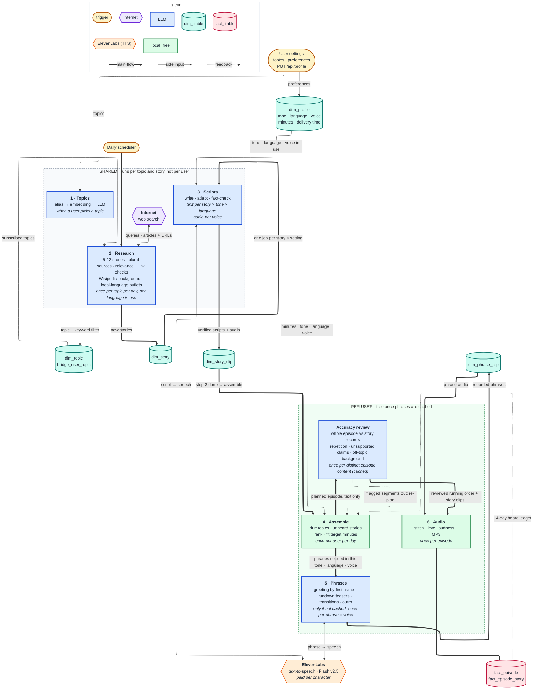
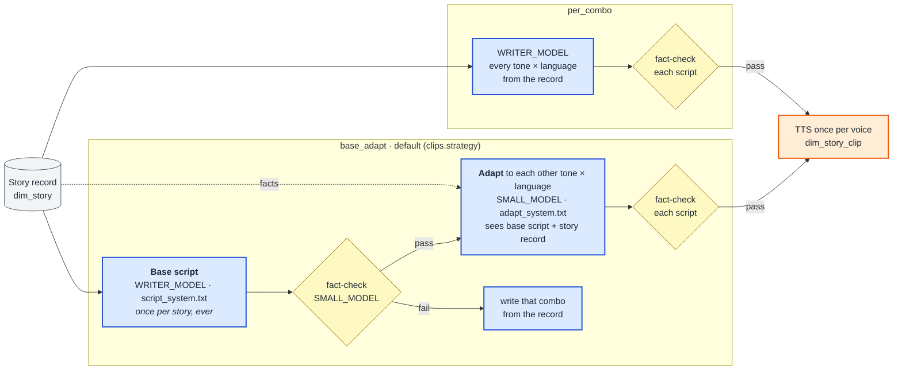

# pipeline/

Turns a user's interests into a daily MP3 episode. The files are numbered in the order they run.

Expensive work is shared: step 2 runs once per **topic**, step 3 once per **story and voice setting**, and step 5's spoken phrases once per **phrase and voice setting**. Per **user** there's only picking stories and joining audio, with no LLM or TTS call once the phrases are cached. That's why cost grows with topics, not users.

Models: research and script writing use the mid-size models (`RESEARCHER_MODEL`, `WRITER_MODEL`); fact-checking, topic matching and phrases use `SMALL_MODEL`. Each LLM step has its system prompt in [prompts/](../../prompts/).

**Legend:** yellow = trigger, blue = LLM, purple hexagon = internet (web search), orange hexagon = ElevenLabs voice (TTS), green = local and free, teal cylinder = `dim_` table (things described), rose cylinder = `fact_` table (events that pile up). Italics = how often the step runs. Thick arrows = the main flow, run in order (2 → 3 → 4 → 5 → review → 6); thin arrows = side inputs; dotted = feedback. Every paid call (steps 1, 2, 3, 5 and the review) is logged to `fact_cost_event`.

| Step | File | Runs | LLM (prompt) | What it does |
|---|---|---|---|---|
| 1 | `step1_topics.py` | when a user selects a topic (Settings page, `PUT /api/profile`) | small, only if no alias/embedding match (`topic_resolve.txt`) | Classifies every selected topic, catalog or free text ("LLMs", "Premier League"), into a shared topic: known alias, then embedding similarity, then one small LLM call. Catalog topics are seeded aliases, so selecting them is free. Niche interests become keyword filters on a broader topic. Subcategories a listener adds under a topic (Film > Cannes Festival) are classified the same cheap way into shared subtopics; stories are tagged with them and rank higher for listeners who follow them. Subscriber counts are refreshed so step 2 researches the topic on its next run. |
| 2 | `step2_research.py` | once per topic per day and research language | researcher + web search (`research_system.txt`) | Finds 5-12 recent stories, **plural in sources** (at most 2 per outlet; other outlets reporting a story are kept and named in its script). Also researched **per language** in that language's own outlets (`research.languages`: e.g. El País, Clarín for Spanish; told today's English headlines so it adds local news); listeners get English stories plus their own language's, which rank 1.5x. Checks: one small-model **relevance** call drops off-topic stories, and background terms that aren't central to their story and the topic; a story whose other sources include a known story is a duplicate; links must be a single article (not a section/tag page) and alive. For lesser-known names it adds **Wikipedia background** (free, in the story's language) that scripts may use to explain. Inline citations stripped, deduped by URL and meaning. Saved as `Story` (+ `language`, `sources`, `background`). |
| 3 | `step3_scripts.py` | script once per story × tone × language; audio once per voice | writer for the base (`script_system.txt`), small adapter (`adapt_system.txt`), small checker (`verify_system.txt`) | Writes one 20-60s base script per story from its stored facts only, then adapts it to each other tone and language (see below), has the small model check every claim with evidence (code re-checks the evidence and that outlet-attributed claims come from what the outlet reported, not the podcast's own framing), gets a second opinion from the writer model on rejections, rewrites once if both reject, then turns it into speech. Another voice reuses the checked script and only records audio. Saved as `StoryClip` and reused by every listener with the same settings. Automatic checks before the fact-check reject a script that: leaves out every figure in the story's facts (data points stay in, as digits), uses a stock line ("That matters because", "Eso importa porque"...), names no source for news, or mentions Wikipedia in background context. A rejected script is rewritten once, then dropped. |
| 4 | `step4_assemble.py` | once per user per day: the daily briefing, then one episode per topic (with 2+ topics) | none | Takes the user's topics that play today (daily, weekdays, or weekly on Mondays with a week of stories) and picks stories they haven't heard in 14 days, skipping filler (importance below 4 of 10), ranked by importance, interest and freshness. Each topic is filled up to its own minutes; the episode lasts at most their sum (max 30) On a slow news day it fills with unheard stories up to 4 days old, then (when `max_explainers` > 0; off by default, since every story now carries its own curiosity) background explainers, each read right after the story it explains and never naming its source; otherwise it is shorter, never padded. **One subject per episode**: a story that tells the same subject as a better one under another headline (shared names + similar headline) is left out. A topic episode keeps its own "already heard" ledger, so it can repeat a story from the briefing. Reuses clips from step 3, then runs steps 5 and 6. |
| 5 | `step5_phrases.py` | once per phrase × voice setting | small (`phrase_system.txt`) | The greeting (by time of day and first name), a "coming up" rundown, transitions and outro are shared phrases, written and recorded only the first time anyone needs them. The rundown line and the transitions use **fixed wording** per language ("Empezamos con Cine.", "Pasamos ahora a Historia."), so they never name the wrong topics and a topic change always sounds like one. Only the rundown's teasers mention news: one short line per story, shared by every listener who gets that story. Saved as `PhraseClip`. |
| 5b | `review.py` | once per distinct episode content (cached in `dim_episode_review`) | small (`review_system.txt`) | **Accuracy review** of the whole episode, before any audio is recorded: see [Quality checks](#quality-checks-accuracy-and-format). Flagged segments are removed and step 4 re-plans without them (at most 2 rounds); what was found and removed is saved in `fact_episode.quality`. If the review call fails the job retries: an unreviewed episode is never recorded. |
| 6 | `step6_audio.py` | once per episode | none | Joins the recorded intro, clips, transitions and outro (the topic-change cue 3 dB under the voice, after an extra 0.7 s pause, never crossfaded into speech), levels loudness to -16 LUFS / -1 dBTP (ffmpeg loudnorm) and saves an MP3 with tags at `storage/audio/users/<user_id>/episodes/<episode_id>.mp3`. |

Main function per step: `set_interests`, `research_topic`, `ensure_clip`, `assemble_episode`, `ensure_phrases`, `review_plan`, `stitch`.

Nothing here decides **when** to run; that's [jobs/](../jobs/). The models, speech and embeddings come from [providers/](../providers/).

## Quality checks: accuracy and format

Accuracy comes first: a segment that fails a check is rewritten once, then left out. An episode is shorter rather than wrong, and nothing is recorded before it passes.

| Level | Checks | Where | Cost |
|---|---|---|---|
| Research (step 2) | Story belongs to the topic; at least one background term per story (general knowledge for the curiosity, fetched from Wikipedia, so it can be fact-checked); background terms are central to the story and the topic (incidental brands or places dropped); article links alive; duplicates by URL and meaning | `_on_topic()` in `step2_research.py`, `prompts/relevance_system.txt` | one small call per research run |
| Each script, format (step 3) | Length; no URLs or markdown; the outlet named (news); **data points kept** (a figure from the facts, as digits); **no stock lines** ("That matters because", "Eso importa porque"...); background **never names Wikipedia**; **tells the news itself** (never "el texto repasa", "the piece looks at"); **one curiosity** for context or perspective from the story's background research, unattributed; no English left in other languages. Cached scripts are re-checked against the current rules every time they are reused, and rewritten if they fail | `local_issues()`, `stale()` in `step3_scripts.py` | free |
| Each script, accuracy (step 3) | Every claim checked against the story record; evidence re-checked in code (`judge()`); a claim attributed to an outlet must be what the outlet reported; second opinion by the writer model on any rejection | `verify_request()`, `judge()`, `prompts/verify_system.txt` | small call per script, writer call only on rejection |
| Each phrase (step 5) | Greeting uses the name; teasers short and ending their sentence; rundown and transitions are **fixed wording** per language ("Empezamos con Cine.", "Pasamos ahora a Historia."), so they can't name the wrong topic | `phrase_issues()`, `RUNDOWN`, `TRANSITIONS` in `step5_phrases.py` | free |
| Each episode, selection (step 4) | **One subject per episode** (shared names + similar headline = the same subject told twice); background only right after the story it explains | `same_subject()`, `drop_same_events()`, `explained_story()` in `step4_assemble.py` | free |
| Each episode, review (5b) | Repeated sentences across segments (free); then one review of the whole episode: the same news told twice, claims not in the record (**teasers included**), background that doesn't explain its story, contradictions | `review.py`, `prompts/review_system.txt` | one small call per distinct episode content |

**Audit stored episodes** (free, no model calls): `python -m app.cli check-episodes --days 1` (or `--episode ID`) re-runs every format rule on each segment, checks one subject per episode and background placement, and prints what the review found and removed. It exits with an error if any episode fails. The `check-accuracy` skill (`.claude/skills/check-accuracy/SKILL.md`) walks through the same audit and how to report a gap.

## Step 3: one base script, adapted (the cheapest way)

A failed script is rewritten once (with the checker's issues) and dropped if it fails again. A story's base can be any fact-checked script of it, conversational English first, so a story is written from scratch once and every later tone or language is a small-model adaptation. Voices never change the words.

**Measured** (2026-11-22, with a since-removed comparison tool) on 5 real stories × 3 tones × 3 languages (45 scripts per strategy, `gpt-5.4-mini` writer, `gpt-5.4-nano` adapter and checker, 2026-11-22). Cost per story is projected to all 24 tone × language combos; first-try pass = fact-checker accepts without a rewrite.

| Adapter input | per_combo pass | base_adapt pass | per_combo $/story | base_adapt $/story |
|---|---|---|---|---|
| base script only | 80% | 82% | $0.0274 | $0.0118 |
| + "no novelty words" rule | 87% | 67% | $0.0265 | $0.0129 |
| **+ story record (current)** | 82% | **89%** | $0.0277 | **$0.0117** |

Without the record, the adapter copied borderline phrases from a passing base into every variant ("a growing set", "read or copied"), and the checker rejected some copies. With the record it drops them. The checker itself is noisy (the same text can pass once and fail once), so treat differences under ~10 points as noise at this sample size. TTS costs the same either way and dominates total cost, so the saving is on LLM spend: about $0.016 per story at 24 combos, and nothing when a story only needs one combo.

