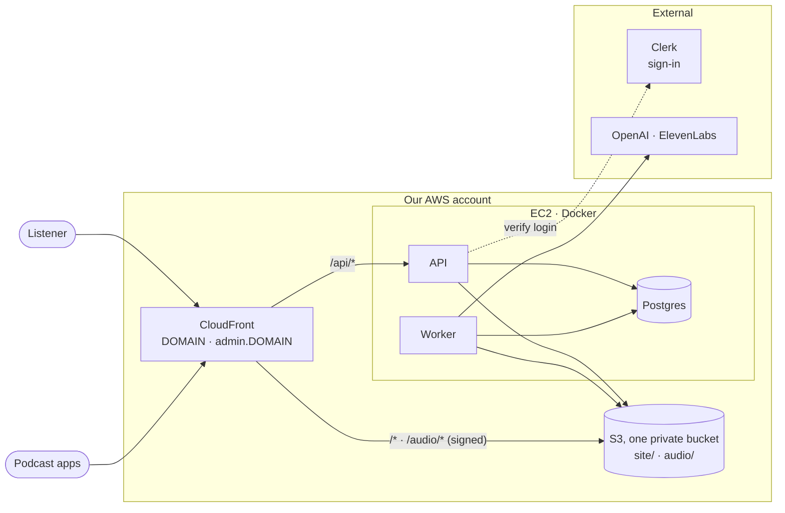

# hearlineCDK/

Hearline on AWS in its cheapest shape (~$25–30/month): **one EC2 server** behind CloudFront.
Everything is code (AWS CDK, Python) and goes out with one command: `./deploy.sh`.

| Piece | Where | Notes |
|---|---|---|
| Website | S3 `site/` + CloudFront | built with the Clerk publishable key; pages route to `index.html`; each deploy replaces only `site/` |
| Admin dashboard | `https://admin.DOMAIN`, same distribution and API | a separate app (`admin.html`); the product address never serves it, and `/api/admin/*` only answers `ADMIN_USER_IDS` |
| API, worker, Postgres | one EC2 server (t4g.medium, 2 vCPU / 4 GB, arm64) | same backend image as local; Postgres data on the server disk |
| HTTPS to the server | Caddy (Let's Encrypt) on `origin.DOMAIN` | answers only CloudFront (secret `X-Origin-Verify` header) |
| Audio | S3 `audio/` (same private bucket) via CloudFront | links signed by the API (24 h); the server can write only `audio/`; the bucket is kept if the stack is deleted |
| Secrets | SSM Parameter Store `/hearline/secrets` (SecureString) | from `hearline/backend/.env`; never in git or the CDK template |
| Backups | daily disk snapshots, 7 kept (Data Lifecycle Manager) | restore = new volume from a snapshot |
| Hardware failure | CloudWatch alarm → EC2 auto-recover | same disk and IP on healthy hardware |
| Logs | CloudWatch Logs `/hearline`, 30 days | one stream per container |
| Shell access | SSM Session Manager (no SSH, no open port 22) | `aws ssm start-session --target <InstanceId>` |

Approximate monthly cost (us-east-1): EC2 t4g.medium ~$24, 30 GB disk ~$2.40, public IP ~$3.60,
snapshots ~$1, Route 53 zone $0.50, CloudFront/S3 cents at launch (1 TB/month free). No load
balancer, NAT gateway or RDS.

## Status

**Not deployed yet.** The code is complete and checked offline: `cdk/test_stack.py` builds the
whole AWS template with placeholder values and asserts its shape (one server, no NAT gateway or
load balancer, site + admin on one CloudFront, `/api` behind the secret header, audio by signed
links only, production settings, daily backups, alerts when an email is set). Nothing has run
against a real AWS account, so the first `./deploy.sh` is also its first real test.

What only a person can do before it (no code left): the six steps under **First deploy** below,
plus three accounts/costs:
- a **paid ElevenLabs plan** (commercial use of the voices; the free plan isn't licensed for it);
- rotate the OpenAI key and delete the `hearline-polly` AWS access key in `hearline/backend/.env` (both
  were exposed in a chat; the server never uses that AWS key, it has its own role);
- the AWS account must allow EC2, CloudFront, Route 53 domains and CloudFormation; if its
  organization's policies restrict any of them, `deploy.sh` stops with *AccessDenied*.

Safety nets already in the code: the backend refuses to start in production with dev login,
SQLite, local audio, a mock LLM or a mock voice (`TTS_PROVIDER` must be set: `pipeline.yaml`
defaults to the mock voice); each deploy records any missing voice samples (cents, once).

Check the stack without AWS: `cdk/.venv/bin/pip install -r cdk/requirements.txt -r
cdk/requirements-dev.txt`, then `cdk/.venv/bin/python -m pytest -q cdk`.

## Files

| File | What it does |
|---|---|
| [config.env](config.env) | domain, region, server size, Clerk keys (public values) |
| [clerk-dns.json](clerk-dns.json) | Clerk's DNS records, created in Route 53 by the stack |
| [deploy.sh](deploy.sh) | the one command: keys, secrets, frontend build, `cdk deploy`, server update |
| [cdk/hearline_stack.py](cdk/hearline_stack.py) | every AWS resource |
| [cdk/test_stack.py](cdk/test_stack.py) | builds the stack offline and checks it (no AWS needed) |
| [scripts/put_secrets.py](scripts/put_secrets.py) | `hearline/backend/.env` keys → SSM (keeps the existing Postgres password) |
| [server/](server/) | runs on the server: `bootstrap.sh` (first boot), `update.sh` (each deploy), `docker-compose.yml`, `Caddyfile` |
| `.secrets/` (gitignored) | generated: CloudFront signing key, origin secret, stack outputs |

## First deploy

1. **Tools on this machine**: AWS CLI (`brew install awscli`), Docker Desktop (running), Node,
   Python 3.
2. **AWS credentials** for the project account: `aws configure` (or `aws sso login`), check
   with `aws sts get-caller-identity`.
3. **Domain**: register it in Route 53 (console → Registered domains). Its hosted zone is
   created automatically. Put it in `config.env` as `DOMAIN`.
4. **Clerk**: create an application, then a **production instance** with the domain. Copy the
   *Publishable key* → `CLERK_PUBLISHABLE_KEY` and the *Frontend API URL* →
   `CLERK_ISSUER` in `config.env`; copy its CNAME records into `clerk-dns.json`. After the
   deploy, press *Verify* in Clerk → Domains. Then, in Clerk:
   - **Sessions → Customize session token**: `{"name": "{{user.full_name}}", "email":
     "{{user.primary_email_address}}"}` (the login account owns the listener's name and email);
   - **Webhooks**: add `https://DOMAIN/api/webhooks/clerk` with `user.created`, `user.updated`,
     `user.deleted`; put its signing secret in `hearline/backend/.env` as
     `CLERK_WEBHOOK_SECRET` (keeps name/email in sync, erases a deleted account);
   - **User & authentication → Restrictions**: allow users to delete their account (the app's
     *Delete account* also removes the Clerk login).
5. **Secrets** in `hearline/backend/.env`: `OPENAI_API_KEY`, `ELEVENLABS_API_KEY`, `LLM_PROVIDER=openai`,
   `TTS_PROVIDER=elevenlabs`, the model names. Optional in `config.env`: `ALERT_EMAIL` (app
   alerts + a monthly AWS budget alarm at `MONTHLY_BUDGET_USD`; confirm AWS's email first).
6. `./deploy.sh`. The first run also bootstraps CDK in the account and takes ~20 minutes
   (certificate validation and CloudFront dominate). The server then installs itself (~5 min).
7. Sign in at `https://DOMAIN`, copy your Clerk user id (Clerk dashboard → Users) into
   `ADMIN_USER_IDS` in `config.env`, and run `./deploy.sh` again to open the dashboard at
   `https://admin.DOMAIN`.

## Each deploy

`./deploy.sh`. CDK rebuilds only what changed (backend image, frontend, infrastructure), then
the server pulls the new image, runs migrations and restarts (`server/update.sh`, ~1 min of API
downtime while containers restart).

Checks after a deploy: `https://DOMAIN/api/plans` answers; CloudWatch Logs `/hearline` has no
errors; `python -m app.cli check` inside the API container verifies keys, models and voices:
`aws ssm start-session --target <InstanceId>` then
`cd /opt/hearline && sudo docker compose exec api python -m app.cli check`.

## Restore from a snapshot

EC2 → Snapshots → pick the date → *Create volume* (same zone) → stop the server → detach its
volume, attach the new one as `/dev/xvda` → start. Audio is in S3 and needs no restore.

## Outgrowing one server

The same image runs on ECS Fargate + RDS + a load balancer (~$90–110/month) when one server
is not enough: move Postgres to RDS (`pg_dump` / `pg_restore`), run the API and worker as ECS
services, and point CloudFront's `/api/*` at the load balancer. Workers already share jobs
safely (`FOR UPDATE SKIP LOCKED`), so more workers is a config change.
