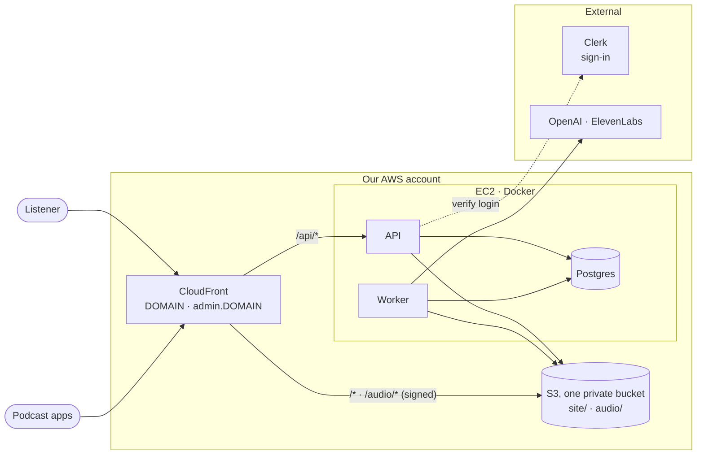
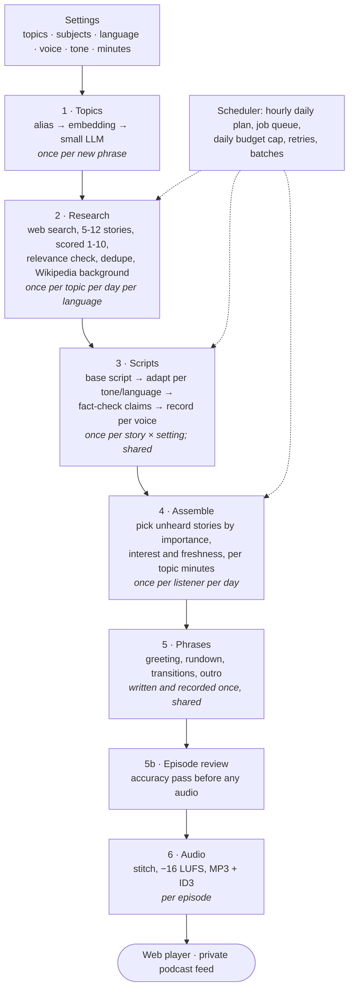

# Hearline: solution overview

Hearline turns the topics a listener follows into a short personal podcast every morning:
researched overnight, written and fact-checked, read in the listener's language, voice and tone,
and delivered in the web app or any podcast player.

The design goal throughout: **pay for content once, share it with everyone who wants it.**
Research, scripts and recordings are shared and cached; only the cheap last step (stitching an
episode) is per listener.

## Try the demo

A static copy of the app with mock data runs with no server and no API keys: the five demo
listeners below, with real episodes generated by the pipeline (real research, fact-checked
scripts, ElevenLabs voices).

- **Online**: `https://hearline.<subdomain>.workers.dev`, a free Cloudflare site built
  from the private GitHub repo on every push (Cloudflare's GitHub connection; setup in the README,
  *Static demo*).
  Anyone with the link can open it; Cloudflare Access can limit it to named emails, also free.
  Admin dashboard (a snapshot): `…workers.dev/admin.html`.
- **Locally**: `cd hearline/frontend && npm install && VITE_STATIC_DEMO=1 npm run dev`, then open
  http://localhost:5173 (dashboard: http://localhost:5173/admin.html). No backend needed.

Choose **Sign in** and enter one of these emails (no password):

| Email | Listener | Language | Plan | Voice | Follows | Episodes |
|---|---|---|---|---|---|---|
| `sofia@example.com` | Sofía | Spanish | Plus | Nova | Film; History, focused on Ancient Egypt | Daily briefing, History, Film |
| `mateo@example.com` | Mateo | Spanish | Plus | Oliver | Technology; Film, focused on the Cannes Film Festival | Daily briefing, Technology, Film |
| `lucia@example.com` | Lucía | Spanish | Free | Aria | Technology, World | Daily briefing, Technology, World |
| `james@example.com` | James | English | Plus | Iris | World; Science, focused on Genetics | Daily briefing, Science |
| `emma@example.com` | Emma | English | Free | Leo | Technology, Science | Daily briefing, Technology |

Each listener has a daily briefing (all their topics) plus one episode per topic. Settings,
plan changes and listening progress work but stay in your browser; the private podcast feed
needs the full app. The demo data is made with `python -m app.cli demo` (the listeners, real
pipeline) and `python -m app.cli export-demo` (the static snapshot in `hearline/frontend/demo-data/`,
only included in demo builds).

## System

**Inside our AWS account**: Route 53 (domain, DNS), ACM (certificate), CloudFront (the single
public entry), one private S3 bucket (`site/` for the web app, `audio/` for clips and episodes,
served only through CloudFront signed links), one EC2 server running the API, the worker and
Postgres in Docker, ECR (the backend image), SSM Parameter Store (secrets and settings),
CloudWatch Logs and alarms with SNS email and AWS Budgets, and daily EBS snapshots.
**External**: Clerk (sign-in), OpenAI (the LLM), ElevenLabs (voices), and the listeners'
browsers and podcast apps. Amazon Polly would move voices inside the account.

Backend `hearline/backend/app/` is split by role: `pipeline/` (what is made), `jobs/` (when),
`providers/` (who does the work: LLM, voice, embeddings, storage), `database/` (where it's kept),
`tracking/` (costs, KPIs, alerts), `api/` (the HTTP surface). The frontend is one codebase with
two apps: the product (landing page for visitors, app for listeners) and the admin dashboard
on its own address.

## The pipeline

## Decisions and why

| Decision | Why |
|---|---|
| Shared, cached content (topics → stories → clips → phrases) | The cost of a story is paid once and reused by every listener with the same settings; per-listener work is only selection and stitching. Measured: ~$0.38 per episode at 20 users falling to ~$0.12 at 200. |
| One base script per story, adapted to other tones and languages by a small model | Far cheaper than writing every combination with the big model; the adapted script is still fact-checked. |
| Voice is the main cost (~65 % in the offline run), so clips are recorded per voice and only on demand beyond the top 4 stories per topic | Prefetching every story wasted 32 % of clips in the 200-user simulation. |
| Free plan: 2 shared voices, 1 tone, 2 topics, short episodes | Each limit is a cost lever: Free listeners share recordings, so they cost almost nothing extra. |
| Accuracy at three levels: per script (claims vs. the story record, second opinion), per episode (review before recording), plus free local checks | A news product must not invent facts; the cheap checks run first, the model checks only where needed. |
| Topics resolved by alias, then embeddings, then one small LLM call | Catalog topics and repeat phrases are free; niche interests become keyword filters on a shared topic instead of new research. |
| Postgres + S3, job queue in the database (`FOR UPDATE SKIP LOCKED`) | No extra queue service; workers scale by adding processes. |
| Clerk for login, no passwords stored | Less risk and code; `dim_user.external_id` links to Clerk. |
| Plans in config, subscription history in `fact_subscription` | Limits change without code; billing can attach later (`provider` / `provider_ref`). |
| AWS: one EC2 server (API, worker, Postgres) behind CloudFront, as code (CDK) | ~$25-30/month instead of ~$90-110 for ECS/RDS/ALB; same images move to ECS when traffic needs it. |
| ElevenLabs voices, with **Amazon Polly as a strong alternative for production** | ElevenLabs was chosen for the simplicity of this test: one API key, natural voices with native speakers in every language. Polly is a good production choice: it is already implemented (`TTS_PROVIDER=polly`, neural voices per language in `config/voices.yaml`), runs inside AWS with the server's own role (no extra vendor or API key), and is cheaper at scale (about $16 per million characters for neural voices). Voice being the largest cost, switching is the biggest single saving. |
| Landing page and product film built from the real app and real data | Sells what the product actually does: real screens, real voices, real numbers (30 topics, 6 voices, 6 languages). |

## Product surface

- **Landing page**: what Hearline does, the film, three steps (topics, how it sounds with
  playable voices, listen every morning), plan popup before sign-up; light/dark from the browser.
- **App**: episodes, player, per-topic settings (frequency, minutes, subjects), style (language,
  voice, tone), subscription, private podcast feed.
- **Admin** (`admin.<domain>`): KPIs, retention, costs, pipeline health; admins only.

## Status

Built and tested: 175 backend tests, lint clean, frontend type-checked with 4 component tests; the AWS stack is checked
offline by `hearlineCDK/cdk/test_stack.py`. **Not deployed yet**: `hearlineCDK/README.md` (*Status*) has
the checklist (domain, Clerk production instance, AWS credentials, `./deploy.sh`).

### Next steps

Need a decision, an account or work outside the code.

| Step | Why | What it takes | Difficulty (current architecture) |
|---|---|---|---|
| Deploy | Nothing runs in AWS yet | Domain, Clerk production instance, AWS credentials, `./deploy.sh` (`hearlineCDK/README.md`) | **Low.** The code is complete and tested offline; a few hours of account setup plus fixing whatever the first real run surfaces |
| Billing for Plus and Pro | Paid plans can't be bought ("paid plans open soon") | Choose Stripe or Clerk Billing; `fact_subscription` already has `provider` / `provider_ref` | **Medium.** Plans, limits and the subscription history exist (`set_plan`, `fact_subscription`); needs checkout, the provider's webhooks and failed-payment handling |
| Privacy policy and terms | Required before an EU launch (GDPR) | Legal text; the pages themselves are small | **Low** in code (two static pages and links); the legal text is the real work |
| Voice provider for production | ElevenLabs' free plan isn't licensed for commercial use | A paid ElevenLabs plan, or switch to Amazon Polly (already implemented) | **Low.** A paid plan is a billing change; Polly is a setting (`TTS_PROVIDER=polly`, voices already mapped) plus re-recording the voice samples |
| Exposed keys | Security | Rotate the OpenAI key; delete the `hearline-polly` AWS key in `hearline/backend/.env` | **Low.** Minutes in the OpenAI and AWS consoles |
| Version control | First commit made; not pushed yet | A private GitHub remote and a push | **Low.** Minutes; CI is already written |

**Product roadmap**

| Step | Why | What it takes | Difficulty (current architecture) |
|---|---|---|---|
| Mobile app | Listening happens on the phone: in the shower, over breakfast, on the commute | iOS / Android app (React Native or native) on the same API: background playback, lock-screen controls, downloads for offline, a push notification when the briefing is ready | **High.** A new client (playback in the background, downloads, push); the API, login (Clerk has mobile SDKs) and audio links are reused as they are |
| Memory across episodes: story arcs, no repeated content | A briefing should feel like one ongoing conversation, not a fresh summary every morning | Hearline already knows what each listener heard (`fact_episode_story`) and links a story to its later updates (`update_of_id`). Built on that: the host **remembers** ("last Tuesday you heard about the export ban; today it changed"); a developing story is followed as an **arc** across days, with a weekly catch-up of the arcs you missed; and **repetition is cut**: what a listener already heard becomes a one-line "what's new" instead of a retelling. The callback and update lines are written once per story and update, then shared, so the cost stays flat | **Medium.** The data exists (who heard what, `update_of_id`); needs grouping stories into arcs (embeddings), a shared callback/update phrase (like step 5's) and a selection rule in step 4 |
| Language-learning mode | Listeners learning a language get their news and their practice in one listen | Hear a story in your language, then the same story in the language you're learning, read slower, with three key words at the end. Every story can already be adapted and recorded in all six languages; each version is made the first time anyone needs it and then shared, so the mode mostly reuses existing clips (a slower reading is one extra recording per story and voice) | **Low–medium.** Per-language clips already exist on demand; needs a new episode layout in step 4, a slower recording and a shared key-words line per story |
| Local layer | News feels personal when it starts where you live | Your city's weather, transit disruptions and local headlines open the briefing. Needs a weather and transit source per city and a "local" research topic; produced once per city and shared by everyone there | **Medium.** New outside data (weather and transit per city), a location in the profile and a per-city research topic; fits the shared model as is |
| Rating system | Today the only feedback is implicit (how far a listener got) | A thumbs up / down per episode and per story, plus "less like this" on a topic; stored per listener and story next to the playback data already kept (`progress_seconds`, completion, replays) | **Low.** One table and migration, two endpoints, buttons in the player; it sits next to the playback data already kept |
| Learning from what works | Episodes should get better for each listener and for everyone | A feedback loop trained on ratings and listening signals as the reward: first, rank stories per listener (bandit-style exploration so new topics still get a chance); then reinforcement learning on generation, preferring the scripts, lengths, tones and orderings that listeners finish and rate well (preference pairs from good vs. skipped episodes to tune the writer prompts, later the models) | **High.** Needs enough ratings first; per-listener story ranking (bandits) is medium, reinforcement learning on generation is high (offline evaluation, preference pairs, a prompt and model tuning loop) |

### Redundancy found and cleaned up

Removed a dead TTS alias (`StubTTSProvider`) and three translation keys no screen used (in all
six languages); fixed the pipeline README to name `set_interests` as step 1's entry point.
Left in place, noted: `subscribe()` / `resolve_topic()` in step 1 are used only by tests (the app
replaces a user's topics with `set_interests()`); the Anthropic SDK is a required dependency
while production uses OpenAI (an optional extra). Both are harmless; worth tidying when step 1
or the dependencies next change.
